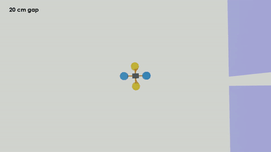
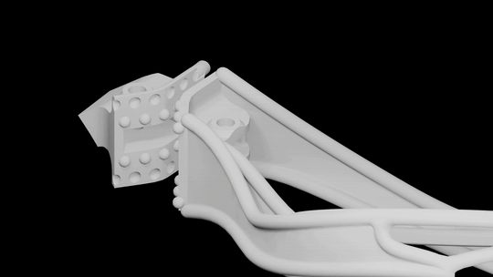
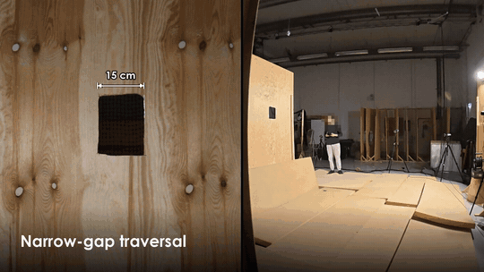
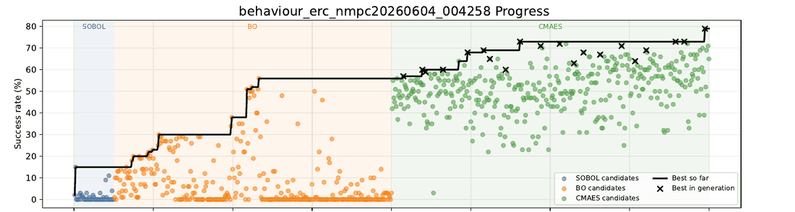

# Task-Driven Closed-Loop Design Optimization of Passively Morphing Quadrotors

<table>
  <tr>
    <th>Simulated gap traversal</th>
    <th>Soft ERC joints</th>
    <th>Validated in the real world</th>
  </tr>
  <tr>
    <td></td>
    <td></td>
    <td></td>
  </tr>
</table>

We jointly optimize a quadrotor's geometry and the torque response of its soft arm joints, using simulated gap-traversal success rate as the objective, so that it passes through openings narrower than itself by folding on contact.

## Installation

- Linux x86-64 (tested on Ubuntu 22.04)
- NVIDIA GPU with a driver that supports CUDA 12.8 (tested on an RTX 4080 Laptop GPU, 12 GB, driver 580)
- About 25 GB of free disk space
- Conda/Miniconda (`curl -O https://repo.anaconda.com/miniconda/Miniconda3-latest-Linux-x86_64.sh && bash Miniconda3-latest-Linux-x86_64.sh`)


```bash
sudo apt-get install build-essential cmake curl ffmpeg git libgl1 libglu1-mesa libsm6 libxt6 libvulkan1
conda create -n soft_drones python=3.11
conda activate soft_drones

./install.sh
```

Installation takes at least 30 minutes, depending also on internet speed. After installation, before running anything, the environment always needs to be activated with `source env.sh` (repeat every time you open a new shell). Sourcing `env.sh` also accepts the [NVIDIA Omniverse License Agreement](https://docs.omniverse.nvidia.com/install-guide/latest/common/NVIDIA_Omniverse_License_Agreement.html) required by Isaac Sim.

Then, check the installation:
```bash
source env.sh
python scripts/check_install.py
```

The first simulator launch and the first solver build take a few extra minutes. The first video recording also pauses for about 2 minutes while Isaac Sim compiles its ray-tracing shaders. These are cached for later runs.

<details>
<summary><b>Alternative installation: Docker</b></summary>

Instead of the steps above, you can run everything in a Docker image. 
Requirements on the host:

- NVIDIA driver as above
- Docker and the [NVIDIA Container Toolkit](https://docs.nvidia.com/datacenter/cloud-native/container-toolkit/latest/install-guide.html), tested with 1.20.1. Old versions such as 1.12 would not work. Check your version with `nvidia-ctk --version`.
- About 30 GB of free disk space for the image

Build the image:

```bash
docker build -t soft_drones .
```

Start a shell in the container. `results/` is mounted from the host so that outputs are kept after the container exits:

```bash
docker run --rm -it --gpus all \
    -v "$PWD/results:/workspace/soft_drones/results" soft_drones
```

`env.sh` is already set in the image, so the commands below can be run in this docker shell without `source env.sh`. 

</details>

## Quick start

A tiny optimization with 7 evaluations takes about 10 minutes on the GPU above. It checks that the whole pipeline works, but its budget is far too small to find a good design.

```bash
source env.sh
python scripts/optimize_design_behaviour_based_nmpc_cma_es.py solve --tiny-test --worker_type_list local --experiment_name tiny_test
```

Results are written to `results/behaviour_based_nmpc_cma_es/tiny_test/`, and each evaluation's files to `cache/workspace_local/`.

## Running the experiments

### Optimization

Run the optimization pipeline (~18h in a Laptop RTX4080).
```bash
python scripts/optimize_design_behaviour_based_nmpc_cma_es.py solve --worker_type_list local --experiment_name my_experiment
```

Resume an interrupted run with:
```bash
python scripts/optimize_design_behaviour_based_nmpc_cma_es.py resume --results_dir results/behaviour_based_nmpc_cma_es/my_experiment --worker_type_list local
```

### Tracking progress

Each run writes its results to `results/behaviour_based_nmpc_cma_es/<experiment_name>/`. Open `progress.pdf` in that folder to follow the optimization. 




## Real-world experiments

<details>
<summary>Click to expand</summary>

`voxl_src/` and `scripts/real_world/` hold most of the relevant code used for the flight experiments on a ModalAI VOXL with a PX4 fork and motion capture. They are included for reference only. **This code is incomplete, is specific to the Voxl2 mini, and will not run as is without adapting it to your hardware**. Building and flashing the voxl2mini firmware depends on a vendor SDK and firmware that cannot be redistributed here because of licensing issues. Contact the main author to get access if necessary.

</details>

## Authors

Etor Arza etora@ntnu.no\
Luca Girardi\
Gabriel Maquignaz\
Javier Paez\
Stefan Leutenegger\
Stefano Mintchev\
Kostas Alexis

